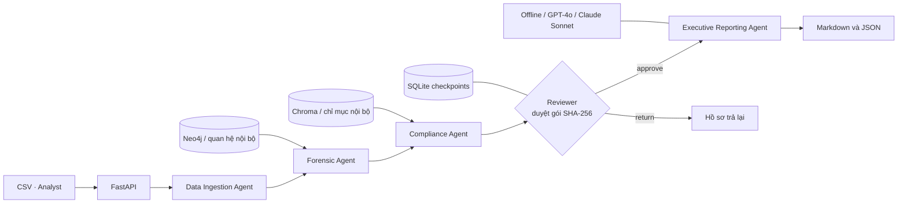

# AMACFA
### Autonomous Multi-Agent Corporate Forensic & Compliance Auditor


**Từ sổ hóa đơn đến báo cáo điều hành có thể truy vết.** AMACFA rà soát công nợ phải trả (AP), nối mỗi tín hiệu rủi ro với dòng dữ liệu và điều khoản kiểm soát nội bộ, rồi chờ kiểm toán viên duyệt gói bằng chứng trước khi xuất báo cáo.

[Báo cáo mẫu](docs/sample-report.md) · [Kiến trúc và triển khai](docs/architecture.md) · [Kịch bản video](docs/demo.md)

## Giá trị nghiệp vụ

Một nhóm kiểm toán có thể rà soát trùng hóa đơn, phê duyệt thiếu hoặc tự phê duyệt, giao dịch có dấu hiệu chia nhỏ và tài khoản nhận tiền dùng chung trong cùng một lượt. Mỗi phát hiện đóng vai trò đầu mối xác minh, kèm dòng CSV, điều khoản áp dụng và bước đối chiếu cụ thể. Người rà soát có thể phản hồi hoặc xác nhận đúng phiên bản gói bằng chứng mà họ đã đọc.

| Tình huống trong demo | Bằng chứng | Kiểm soát |
| --- | --- | --- |
| Hai hóa đơn trùng số sau chuẩn hóa | Dòng 2–3 | `AP-01` |
| Hóa đơn 12.000 USD thiếu phê duyệt | Dòng 4 | `AP-02` |
| Cùng người đề nghị và phê duyệt | Dòng 5 | `AP-03` |
| Hai khoản dưới hạn mức đạt tổng 10.300 USD trong bảy ngày | Dòng 6–7 | `AP-04` |
| Hai nhà cung cấp dùng chung token tài khoản | Dòng 8–9 | `AP-05` |

## Kiến trúc



- **StateGraph bền vững.** SQLite lưu checkpoint đồng bộ. API dùng UUID làm mã hồ sơ và khóa idempotency. LangGraph tạm dừng qua `interrupt()` và tiếp tục bằng `Command(resume=...)`.
- **Bằng chứng có thể đối chiếu.** SHA-256 cho CSV gốc, từng dòng chuẩn hóa, gói duyệt và tệp báo cáo. Neo4j truy vấn đường dẫn nhà cung cấp → hóa đơn → tài khoản với phạm vi theo hồ sơ.
- **Policy RAG có ranh giới rõ.** Điều khoản áp dụng đến từ ánh xạ quy tắc đã định phiên bản. Chroma truy hồi điều khoản tham khảo. LLM chỉ đề xuất thứ tự ưu tiên của các phát hiện đã có, với structured output được xác thực và thứ tự mặc định khi nhà cung cấp gặp lỗi.
- **Đánh giá có nhãn.** So khớp bộ ba `(quy tắc, tập dòng, mã kiểm soát)` trên hai bộ dữ liệu tổng hợp. Kết quả demo kỳ vọng là 5 true positives, 0 false positives, 0 false negatives.

## Chạy trong vài phút

Cần **Python 3.13**. Từ thư mục AMACFA, chạy bằng PowerShell.

```powershell
py -3.13 -m venv .venv
Copy-Item .env.example .env
.\.venv\Scripts\python.exe -m pip install -r requirements-dev.txt
.\.venv\Scripts\python.exe -m uvicorn main:app --host 127.0.0.1 --port 8000 --workers 1
```

Mở terminal thứ hai trong thư mục dự án. Dùng `--interactive` để nhập quyết định `approve` hoặc `return` sau khi xem bằng chứng.

```powershell
.\.venv\Scripts\python.exe -m scripts.demo --interactive
.\.venv\Scripts\python.exe -m scripts.evaluate
.\.venv\Scripts\python.exe -m pytest -q
```

Demo lưu JSON hồ sơ và Markdown đã duyệt trong `.amacfa/demo/`. Swagger UI nằm tại [localhost:8000/docs](http://127.0.0.1:8000/docs). Các endpoint nghiệp vụ yêu cầu Bearer token của `analyst` hoặc `reviewer`, tùy thao tác.

### Bật Chroma và Neo4j

```sh
docker compose up --build -d
docker compose ps
```

Stack Compose đọc `.env` và công bố API qua localhost. Dùng terminal thứ hai chạy lại demo với cùng lệnh PowerShell. Xem [cấu hình LLM, API và hướng dẫn kiểm thử](docs/architecture.md) để chạy từng adapter.

## Cấu trúc mã nguồn

```text
main.py                    FastAPI, xác thực vai trò, giới hạn upload
amacfa/
  agents/                  Ingestion, forensics, compliance, reporting
  tools/                   CSV, quy tắc, Chroma, Neo4j, OpenAI/Anthropic
  workflows/               StateGraph, trạng thái hồ sơ, idempotency
  policies/ap-v1.json       Chính sách AP giả lập có phiên bản
data/                      CSV đã gán nhãn và đối chứng
scripts/                   Demo qua HTTP và đánh giá có thể chạy lại
tests/                     Kiểm thử API, quy tắc và adapter
docs/                      Kiến trúc, hướng dẫn quay và báo cáo mẫu
```

AMACFA là portfolio kiểm toán AP dùng dữ liệu tổng hợp và chính sách nội bộ giả lập. [Phạm vi và các hạng mục cần hoàn thiện trước khi xử lý dữ liệu thật](docs/architecture.md#phạm-vi-triển-khai).
